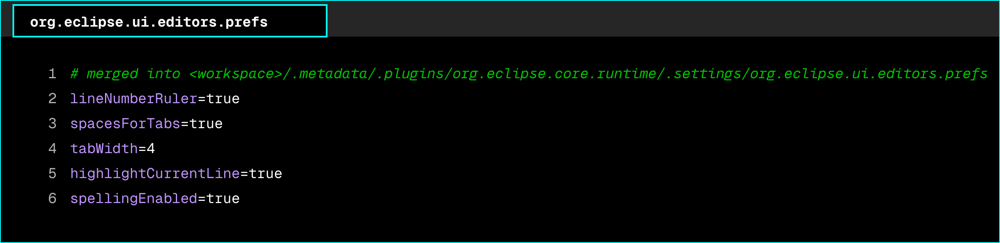

# stm32cubeide-config

This repository's STM32CubeIDE configuration has moved to the `editors/stm32cubeide` folder of the dotfiles repository, where it is maintained together with the rest of the developer setup. Changes and issues are handled there.

[Open editors/stm32cubeide in dotfiles](https://github.com/zaccesss/dotfiles/tree/main/editors/stm32cubeide)

> [!NOTE]
> This repository is archived and read-only.

